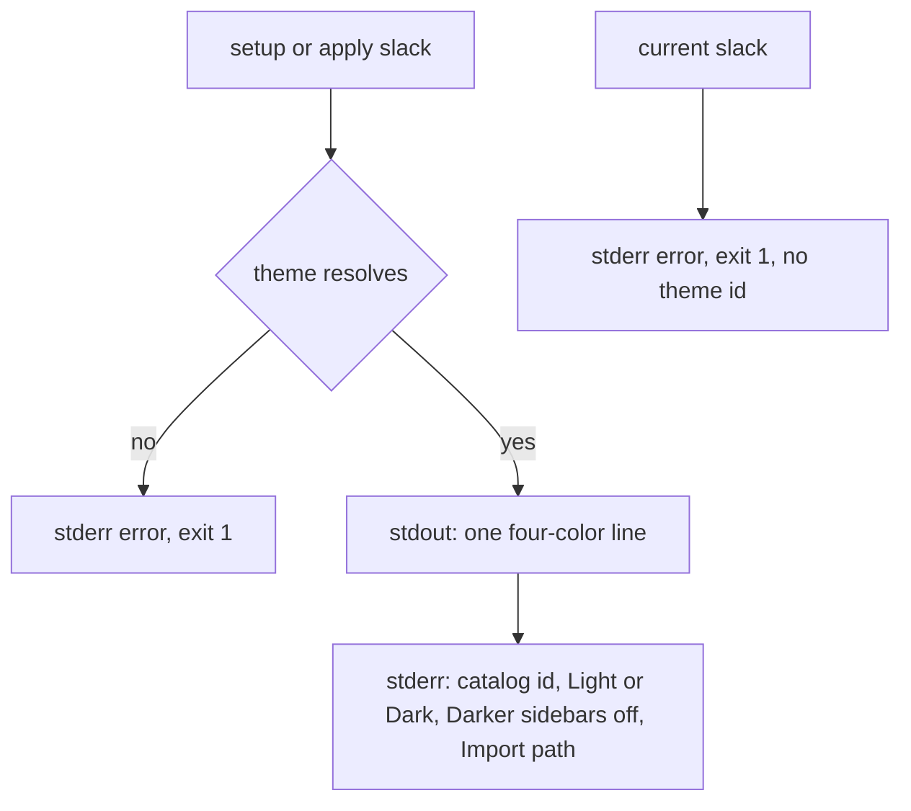
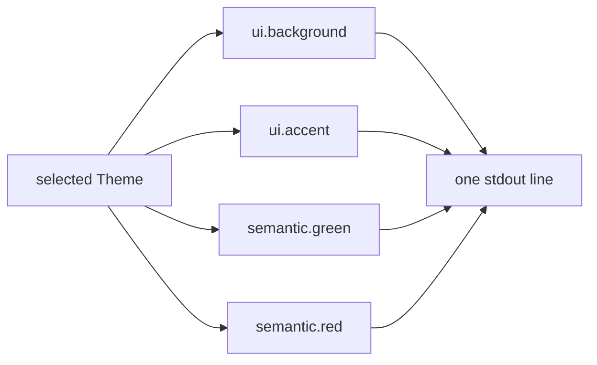

# Slack Theme Support - Plan

## Goal Capsule

- **Objective:** A person can take a Street Fighter II theme from this pack and import it as their Slack custom theme.
- **Means:** Print a four-color Slack import string and paste instructions from the catalog (KTD1, KTD2).
- **Authority:** Product Contract requirements win on behavior. Key Technical Decisions win on mechanism. Implementation units follow both.
- **Execution profile:** code
- **Stop conditions:** Stop if Slack support would need a theme API, a config file, a string length other than four, a catalog color change, or a website change.
- **Finishes and ships:** An implementer completes U1, U2, and U3. The repository owner ships.

---

## Product Contract

### Summary

The CLI will print a Slack custom-theme string for any catalog theme, with the steps to import it.
Slack has no config file this pack can write.
The string covers Slack's four current theme roles, and the user pastes it.

### Problem Frame

The pack installs the same 36 themes into local terminal and editor apps by writing those apps' config files.
Slack's custom theme is a preference inside the Slack client.
Someone who already uses an SF2 theme in the terminal has no Slack target in this pack.
Catppuccin publishes Slack themes as a string the user pastes, which is the delivery this request asked to follow.

### Requirements

- R1. `sf2-themes apply slack` and `sf2-themes setup slack` print one Slack import string for the theme named by `--theme`, and for `main` when `--theme` is omitted.
- R2. A light catalog id prints that light theme's colors, and a dark catalog id prints that dark theme's colors.
- R3. The same commands tell the user where to paste the raw string and which Slack Color Mode to set.
- R4. `sf2-themes current slack` fails and prints no theme id.
- R5. Slack commands create, update, and delete no files.

### Key Decisions

- KD1. Slack support is a string the user pastes into Slack's custom theme. Slack documents Import theme and does not document a theme file or a public theme API. Governs R1, R3, R5.

### Key Flows

- F1. Paste a theme
  - **Trigger:** The user runs setup or apply for `slack`.
  - **Steps:** The CLI resolves the theme, prints one import line, and prints the Color Mode and Import steps.
  - **Outcome:** The user pastes the line into Slack. The CLI cannot see whether Slack accepted it.
  - **Covered by:** R1, R2, R3, R5

### Acceptance Examples

- AE1. Apply Ken
  - **Covers:** R1, R2, R3
  - **Given:** The `ken` theme.
  - **When:** The user runs `sf2-themes apply slack --theme ken`.
  - **Then:** Standard output is `#221616,#de6767,#549657,#c76e67` and standard error says Dark, tells the user to turn Darker sidebars off, and names Preferences, Appearance, Custom theme, Import theme.

- AE2. Apply Ken light
  - **Covers:** R2, R3
  - **Given:** The `ken-light` theme.
  - **When:** The user runs `sf2-themes apply slack --theme ken-light`.
  - **Then:** Standard output is `#faeeed,#af3c40,#2d7633,#a94a46` and standard error says Light.

- AE3. Ask what Slack is using
  - **Covers:** R4, R5
  - **Given:** Any prior apply, including none.
  - **When:** The user runs `sf2-themes current slack`.
  - **Then:** The command exits non-zero, prints no theme id, and leaves the filesystem unchanged.

- AE4. Dry-run
  - **Covers:** R1, R5
  - **Given:** The `ken` theme.
  - **When:** The user runs `sf2-themes apply slack --theme ken --dry-run`.
  - **Then:** Standard output matches AE1 and the command creates no file.

### Scope Boundaries

- The website, generated SVG previews, catalog TOML, and the `pyproject.toml` description stay as they are.
- The CLI does not copy the string to the clipboard.
- The CLI does not call Slack.

#### Deferred to Follow-Up Work

- A second string for pre-redesign Slack, the ten-color form Catppuccin still publishes.
- Slack on the Astro install page and theme pages.
- Reading the applied Slack theme if Slack later documents a supported preferences API.

#### Outside this product's identity

- This pack does not become a Slack app, a Stylus userstyle, or a desktop CSS injector.

### Sources

- [catppuccin/slack](https://github.com/catppuccin/slack) `slack.tera` at `56179f8` publishes ten uppercase colors. Slot 2 is the literal `#F8F8FA` on every flavor.
- [Change your Slack theme](https://slack.com/help/articles/205166337-Change-your-Slack-theme) still documents Custom theme, Share, and Import of a legacy string. Fetched 18 October 2026.
- [A new visual language for Slack](https://slack.design/articles/a-new-visual-language-for-slack/) says the redesign took nine inputs down to four and mapped colors onto predetermined palettes.
- A 5-8 October 2026 import test, [Slack Themes](https://slack.green/en/blog/slack-themes), reports that Import accepts 4, 8, or 10 colors and keeps legacy positions 1, 3, 7, and 8. Slack help does not name those four fields.
- [catppuccin/slack issue 10](https://github.com/catppuccin/slack/issues/10) asks for four colors. The generator was not switched.
- Local adapter contract: `src/sf2_theme/cli.py`, `src/sf2_theme/filesystem.py`, `src/sf2_theme/model.py`, `docs/theme-guidelines.md` section 9, `mise-tasks/build-standalone`.

---

## Planning Contract

### Key Technical Decisions

- KTD1. The import line is four lowercase `#RRGGBB` values, comma-separated, with no spaces, in the order `ui.background`, `ui.accent`, `semantic.green`, `semantic.red`. The map lives in the Slack adapter. On `ken`, `ui.selection_background` against `ui.background` is 1.48:1 and `ui.accent` against `ui.background` is 5.23:1, so the selected-item slot uses accent. Catppuccin's ten-color template was rejected because a current Import keeps four roles, and truncating that template puts the hardcoded `#F8F8FA` in the selected-item slot. Both formats were already published, so the choice is this judgment rather than a build of both.
- KTD2. Standard output is exactly that one line, including setup, apply, the deprecated `install` alias, and dry-run. Instructions go to standard error. Slack commands do not go through the file reporter and do not return a write result.
- KTD3. The command pins the requested theme. It does not resolve a dark/light pair. An omitted `--theme` is `main`, which is dark. Standard error says Light or Dark from that theme's variant.
- KTD4. `current slack` always fails with the existing theme error, ignores `--theme`, and writes nothing. Slack ignores `--config-dir`, `--follow-symlinks`, and `--adopt`. There is no Slack config root.

### High-Level Technical Design





The line grammar is:

```text
line = color "," color "," color "," color newline
color = "#" hex hex hex hex hex hex
hex = "0"-"9" / "a"-"f"
```

Standard error names the catalog id (`ken`, not `sf2-ken`), says Light or Dark, tells the user to turn Darker sidebars off, and points at Preferences, Appearance, Custom theme, Import theme.
The user pastes the raw line.
The Share sentence Slack copies is not valid Import input, so the CLI does not print it.

### Assumptions

- This work belongs in the SF2 Themes pack, the local catalog that already installs these themes into other apps.
- Every catalog theme gets a string. The request did not name a subset, and the other targets cover the catalog.
- The four field names and their order come from the October 2026 import test. Slack's help article does not name them.
- The request pointed at Catppuccin's Slack repo and did not confirm replacing its ten-color template. KTD1 makes that replacement from the import evidence.
- Both light and dark themes tell the user to turn Darker sidebars off, because Import can leave that checkbox on and the checkbox is not part of the string.
- Slack may adapt the pasted hex for contrast. The objective is met when Import accepts the line. Pixel equality with the terminal theme is not required.
- The Astro site stays unchanged. Its install page is a hand-written list and already omits Lazygit.

### Sequencing

U1 locks the string. U2 wires the commands and the generated executable. U3 updates the docs that currently say every adapter installs an `sf2-` identity and maps the full token set.

### System-Wide Impact

`slack` becomes a public app name in `APP_NAMES`, help text, and the generated root executable.
A script that runs `current` for every name from `apps` will fail on `slack`.
That failure is R4.
No other adapter's files, identity prefix, or symlink policy changes.

### Risks

- The four-role order is third-party evidence. U1 locks the `ken` line, so a later Import change shows up as a KTD1 edit rather than a second string. This plan does not add a Slack login to CI.
- Slack's contrast pass can paint a different hex than the catalog. The objective stops at Import accepting the line, which Assumptions already records.
- Menu labels differ across writeups. KTD2 follows the current help article. A client with no Custom theme control is the deferred pre-redesign path, and this plan does not add a second instruction paragraph.
- `docs/theme-guidelines.md` section 9 says each adapter maps the complete semantic contract. U3 is what stops an implementer from emitting a ten-color string to satisfy that sentence.

---

## Implementation Units

### U1. Slack import string

- **Goal:** Turn one catalog theme into the four-color line from KTD1.
- **Requirements:** R1, R2
- **Dependencies:** none
- **Files:** `src/sf2_theme/adapters/slack.py`, `tests/test_slack.py`
- **Approach:** Read colors from the `Theme` passed in. Keep the four-slot map in this module. Do not add roles to `project_adapter_colors()`. Do not call `theme_pair()` or `write_file`.
- **Execution note:** Write the string contract tests first. The line is the product.
- **Patterns to follow:** Color reads in `src/sf2_theme/adapters/claude.py`. Catalog ids and `Theme.metadata.variant` in `src/sf2_theme/model.py`.
- **Test scenarios:**
  - `ken` renders `#221616,#de6767,#549657,#c76e67`.
  - `ken-light` renders `#faeeed,#af3c40,#2d7633,#a94a46`.
  - `main` renders `#131927,#ad8705,#4e975b,#c86e67`.
  - The line is one line, lowercase, with commas and no spaces.
  - Slot 2 equals `ui.accent` and does not equal `ui.selection_background` on `ken`.
  - The line is not Catppuccin's ten-color shape and does not contain `#F8F8FA`.
  - The four `ken` values are four different colors.
- **Verification:** `tests/test_slack.py` passes for those three themes and the slot rules.

### U2. CLI commands and standalone executable

- **Goal:** `slack` is a real app name whose setup, apply, and current behavior match R1 through R5 and KTD2 through KTD4.
- **Requirements:** R1, R2, R3, R4, R5
- **Dependencies:** U1
- **Files:** `src/sf2_theme/cli.py`, `mise-tasks/build-standalone`, `mise-tasks/test-cli`, `tests/test_slack.py`, `tests/test_cli.py`, generated `sf2-themes`
- **Approach:**
  - Append `slack` to `APP_NAMES` and add the three command arms.
  - Say in `HELP_TEXT` that Slack prints a paste string and does not install an `sf2-` identity.
  - Print the U1 line on standard output and the KTD2 instructions on standard error.
  - Add the adapter module to `MODULES` before `sf2_theme.cli`.
  - Regenerate `sf2-themes`. Do not hand-edit it.
  - Extend `mise-tasks/test-cli` so the copied executable prints the `ken` line, creates no Slack file, and fails `current slack`.
- **Patterns to follow:** The `match` arms and `APP_NAMES` allow-list in `src/sf2_theme/cli.py`. Stderr hints in the Starship and WezTerm adapters. The copied-CLI checks in `mise-tasks/test-cli`.
- **Test scenarios:**
  - `apps` includes `slack`.
  - `apply slack --theme ken` exits 0, standard output equals the U1 `ken` line, and standard error includes Dark, Darker sidebars off, Appearance, and Import theme.
  - `apply slack --theme ken-light` prints the U1 light line and says Light.
  - `apply slack` with no `--theme` prints the U1 `main` line and says Dark.
  - `setup slack --theme ken` matches apply on standard output.
  - `apply slack --theme ken --dry-run` matches apply on standard output and creates no file.
  - `current slack` exits non-zero, prints no theme id, and creates no file.
  - `apply slack --theme no-such` uses the existing unknown-theme error.
  - `install slack --theme ken` prints the deprecation warning on standard error, and standard output is still only the color line.
  - `--adopt` and `--config-dir` do not create a directory and do not change the color line.
- **Verification:** The pytest cases above pass, the regenerated `sf2-themes` matches the builder, and `mise-tasks/test-cli` covers the copied executable.

### U3. Docs for a paste target

- **Goal:** The written adapter rules name Slack's four tokens and stop saying every target installs an identity.
- **Requirements:** R1, R3
- **Dependencies:** U1
- **Files:** `README.md`, `docs/theme-guidelines.md`, `src/sf2_theme/adapters/AGENTS.md`
- **Approach:** Add Slack to the app list as a paste string. In section 9, state that Slack receives `ui.background`, `ui.accent`, `semantic.green`, and `semantic.red`, and that the rest of the theme contract has no Slack field. Note in the adapter guide that Slack has no `write_file` path and that `current` fails closed.
- **Patterns to follow:** The per-app sentences already in `docs/theme-guidelines.md` section 9.
- **Test scenarios:**
  - Test expectation: none. This unit is documentation. U1 and U2 cover the behavior.
- **Verification:** A reader of the README, section 9, and `src/sf2_theme/adapters/AGENTS.md` can see that Slack prints four tokens, does not install `sf2-<id>`, has no file write, and that `current` fails closed.

---

## Verification Contract

| Gate | Command | Applies |
|---|---|---|
| String and CLI tests | `uv run pytest -q tests/test_slack.py tests/test_cli.py` | U1, U2 |
| Regenerated executable | `mise run build-standalone` then `mise run test` | U2 |
| Lint | `mise run lint` | U1, U2, U3 |
| Website | none | The Astro install page and theme pages are unchanged |

`mise run test` already includes the copied-CLI harness and the standalone freshness check.
Do not hand-edit `sf2-themes` or `docs/previews/`.

---

## Definition of Done

- U1's three theme lines and slot rules pass.
- U2's stdout, stderr, dry-run, and `current slack` cases pass, including through the copied executable.
- U3's README, section 9, and `src/sf2_theme/adapters/AGENTS.md` name the four tokens, the paste behavior, the lack of a file write, and the closed `current` command.
- `mise run test` and `mise run lint` pass.
- The diff does not change catalog TOML, `docs/previews/`, or `web/`.
- Abandoned attempt code is removed before the work is called done.
