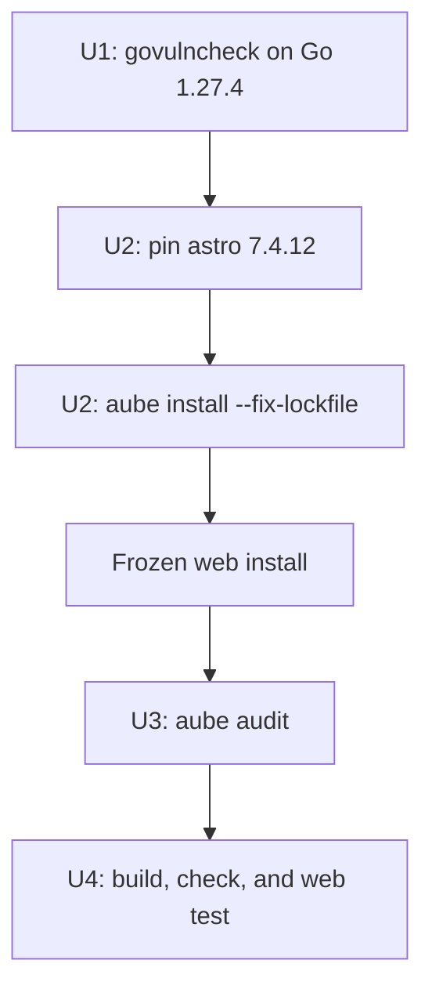
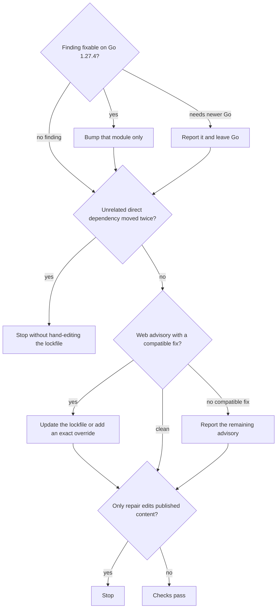

# Astro 7.4.12 Upgrade - Plan

## Goal Capsule

**Objective:** The published SF2 Themes site runs on Astro 7.4.12, its pages still say what they say today, and no known advisory remains that a compatible dependency bump can remove.

**Means:** Pin Astro at exactly 7.4.12 and re-resolve that lockfile entry, including the transitives it pulls, then change any other dependency only when a fresh scan reports an advisory (KTD1, KTD3, KTD4).

**Authority:** The user's upgrade request, then the repository's aube and content rules, then the published Astro 7.4.12 manifest.

**Execution profile:** Four units in one pull request. U1, U3, and U4 edit files only when a scan or a check requires it.

**Stop conditions:** Do not edit published pages, public files, or authored docs. Do not change Go off 1.27.4. Do not hand-edit the lockfile. Stop if an unrelated direct dependency keeps moving. Stop if the only repair is a content edit. Do not merge and do not force-push.

**Finishes the work:** The implementing agent lands the units and opens one pull request against the default branch. CI is watched until it is green.

---

## Product Contract

### Summary

Move the site from Astro 7.4.11 to 7.4.12, refresh the aube lockfile, and clear any advisory a fresh audit or govulncheck can fix without changing pages or the Go version.

### Problem Frame

The site is one patch behind the Astro release the user named. 7.4.11 is already past the October 2026 script and style XSS, which is fixed in 7.3.2, and past the same-day CSS injection, which is fixed in 7.3.3. Landing 7.4.12 is the remaining release step, and the dependency tree still has to be shown clean.

### Requirements

**Release**

- R1. `web/package.json` pins `astro` at exactly `7.4.12`.
- R2. Every installed `@astrojs/*` package is a version Astro 7.4.12 accepts, and the site gains no new integration.

**Install and proof**

- R3. `web/aube-lock.yaml` is regenerated with aube so a later frozen install does not rewrite it.
- R4. The production build, the typecheck, and the existing web tests pass.

**Security**

- R5. After the bump, a fresh aube audit and a fresh govulncheck show no advisory that a compatible version bump can fix.
- R6. Go stays on 1.27.4. There is no Encore app, so 1.27.3 does not apply.

**Content and shipping**

- R7. Published pages, `web/public`, and authored docs keep their current text. Generated theme data is not rewritten.
- R8. Local checks cover lint, typecheck, tests, and build, plus the CI web install and Pages build this diff selects.
- R9. The work lands as one open pull request against the default branch. It is not merged, and its branch is not force-pushed.

### Success Criteria

- A visitor of the built site still sees the same pages, install text, and theme catalog after the site is built on Astro 7.4.12.
- Any advisory that remains because no compatible fix exists is named on the pull request.

### Acceptance Examples

- AE1. Given Astro was pinned at 7.4.11, after the lockfile re-resolve the spec is 7.4.12, `@astrojs/markdown-satteri` is 0.4.10, `@astrojs/vite-plugin-astro` is 0.1.3, and a frozen install does not change the lockfile. Covers R1, R3.
- AE2. Given a clean audit and a clean govulncheck, the four existing overrides and `go.mod` stay unchanged. Covers R5, R6.
- AE3. Given the current pages, the production build and the existing browser tests pass, and the page sources are unchanged. Covers R4, R7.

### Scope Boundaries

No new Astro integration, no `@astrojs/markdown-remark`, and no content collections. npm, pnpm, yarn, and npx stay unused. No audit or govulncheck ignore file is added. The Go version in `go.mod` and `mise.lock` stays 1.27.4. Catalog generators and parity goldens stay untouched unless a module bump changes CLI bytes. Nested Docker is not a local check.

#### Deferred to Follow-Up Work

- Wiring govulncheck into `mise.toml` or CI.
- Adding Astro's recommended `.astro/types.d.ts` include to `web/tsconfig.json`. That gap predates this patch.

---

## Planning Contract

### Key Technical Decisions

- KTD1. **Pin `astro` to the exact version 7.4.12.** On 2026-11-16 the npm `latest` tag for `astro` is 7.4.12. This repo uses exact specifiers. A caret, or `aube update --latest`, can move past the requested version.
- KTD2. **Leave `@astrojs/check` at 0.9.12 and add no integration.** `web/astro.config.mjs` has no integrations array. `@astrojs/check@0.9.12` is still the npm latest tag, and Astro 7.4.12 lists that same version in its own devDependencies. The packages whose floors rose are transitive: `@astrojs/markdown-satteri` 0.4.9 to 0.4.10, and `@astrojs/vite-plugin-astro` 0.1.2 to 0.1.3.
- KTD3. **Re-resolve with `aube install --fix-lockfile` after the specifier edit.** `aube update` without `--latest` stays on the exact 7.4.11 spec. Deleting `web/aube-lock.yaml` re-resolves unrelated trees such as stagehand, Playwright, and TypeScript. The narrow install re-resolves the drifted Astro entry and the transitives it pulls.
- KTD4. **Change another dependency only when a fresh scan prints an advisory.** A 2026-11-16 audit of the current tree and of a lockfile-only 7.4.12 probe reported zero advisories. govulncheck v1.9.0 on Go 1.27.4 reported none. Re-run both after the bump. For a web advisory, update the lockfile inside existing ranges first, then add an exact override only when that cannot move the package. Keep `sharp` at an exact 0.35.x inside `^0.35.4`, and do not override `@img/sharp-*` separately. For a Go advisory, bump that module on Go 1.27.4. Run govulncheck v1.9.0 with `GOTOOLCHAIN=local` so the scanner is not added to `go.mod` and a newer toolchain is not downloaded. If that scanner no longer builds on Go 1.27.4, report that and do not switch toolchains.

### High-Level Technical Design

### Assumptions

- A1. The narrow resolve moves `astro` to 7.4.12, `@astrojs/markdown-satteri` to 0.4.10, and `@astrojs/vite-plugin-astro` to 0.1.3, plus the integrity and snapshot keys for those entries. An extra edge inside the Astro graph that a second identical resolve reproduces is kept. An unrelated direct dependency that both resolves move stops U2.
- A2. The fresh audit and govulncheck stay clean, so U1 and U3 edit no files.
- A3. A frozen local install stands in for the dev image's `aube ci`. Pull-request CI will miss the published dev-image tag and build `docker/dev/Dockerfile` itself. This environment does not run nested Docker.
- A4. This patch does not change rendered HTML for this site. If an existing assertion fails and the only repair edits a page, a public file, or that assertion of authored content, U4 stops.
- A5. `mise run verify` is the local repo gate even when path-filtered CI skips the Go jobs for a web-only diff.

### Sequencing

U1, then U2, then U3, then U4. U1 runs first so a Go module edit is known before the web diff is treated as web-only.

### System-Wide Impact

`scripts/ci/dev-image-fingerprint.sh` hashes `web/package.json` and `web/aube-lock.yaml`. `.github/workflows/publish-images.yml` publishes the new dev image on push to `main`, not on the pull request. `.github/workflows/verify.yml` and `.github/workflows/deploy.yml` will build `docker/dev/Dockerfile` during the pull request and run `aube ci` there. A diff limited to the web manifest and lockfile selects the web verify job and does not select the Go job. `deploy.yml` still builds the site on every pull request and does not deploy it.

### Risks & Dependencies

- The resolver moves more than A1 allows. Run the narrow resolve a second time. If an unrelated direct dependency still moves, stop. Do not hand-edit the lockfile.
- A prefer-frozen local install can pass on an already-linked tree while the pull request's `aube ci` fails. Prove the lockfile with a frozen install before opening the pull request.
- An existing HTML assertion fails. Follow A4. Do not edit page source to absorb a serialization change.
- A vulnerability database published after 2026-11-16 reports a Go issue whose only fix is a newer toolchain. Report it under R5 and leave Go at 1.27.4.

### Sources

- npm `latest` for `astro` was 7.4.12 on 2026-11-16. Release notes: `https://github.com/withastro/astro/releases/tag/astro@7.4.12`. The patch unpins `@astrojs/*` ranges and raises the floors of `@astrojs/markdown-satteri` and `@astrojs/vite-plugin-astro`. It does not change the preview flags `--host`, `--port`, or `--ignore-lock`.
- GHSA-98hj-9722-w3j8 is fixed in Astro 7.3.2. GHSA-mpr7-6m5w-76rw still affects 7.3.2 and is fixed in 7.3.3. Both are already absent from 7.4.11.
- `@astrojs/check` latest was 0.9.12 on the same date.
- Local pins and call sites: `web/package.json`, `web/astro.config.mjs`, `web/aube-lock.yaml`, `web/tests/e2e/run.mjs`, `web/tests/unit/package-contract.test.mjs`, `go.mod`, `mise.toml`, `mise.lock`.

---

## Implementation Units

### U1. Scan Go with govulncheck

- **Goal:** Know whether the Go module has an advisory a 1.27.4-compatible bump can fix, and apply only that bump.
- **Requirements:** R5, R6
- **Dependencies:** none
- **Files:** `go.mod` and `go.sum` only if a finding requires a module bump. `internal/parity` tests only if `github.com/BurntSushi/toml` moves and parser bytes change.
- **Approach:** Run the scanner in KTD4 from the repo root. A clean result leaves Go files untouched. A finding is fixed by bumping that module to a release that still builds on Go 1.27.4. A `github.com/BurntSushi/toml` bump must keep the parity parser corpus passing. A finding whose only fix is a newer Go is reported and left.
- **Execution note:** Scan first. Do not add the scanner to the module to install it.
- **Patterns to follow:** `go.mod` has no `toolchain` line. `mise.lock` resolves Go 1.27.4. `internal/AGENTS.md` keeps BurntSushi/toml on a release that still reads TOML 1.0 by default.
- **Test scenarios:**
  - Clean scan: `go.mod` and `go.sum` are unchanged, and the Go version is still 1.27.4.
  - A finding names a module with a patched release that supports Go 1.27.4: only that module moves, and `go test` for the affected packages passes.
  - The only patched release needs a newer Go: `go.mod` stays unchanged and the advisory is reported.
  - BurntSushi/toml moves: the parser-corpus tests in `internal/parity` pass without a hand-edited golden.
- **Verification:** The scanner is not a `go.mod` requirement. `mise.lock` still resolves Go 1.27.4. A clean scan produces no Go diff.

### U2. Pin Astro 7.4.12 and re-resolve the lockfile

- **Goal:** The manifest pins Astro 7.4.12 and the lockfile matches a frozen install.
- **Requirements:** R1, R2, R3
- **Dependencies:** U1
- **Files:** `web/package.json`, `web/aube-lock.yaml`
- **Approach:** Change only the `astro` specifier, per KTD1 and KTD2. Leave the four overrides. Re-resolve per KTD3. Apply A1 to any extra version move. Do not delete the lockfile and do not hand-edit it. Keep `web/.npmrc` on `node-linker=hoisted`.
- **Execution note:** This is packaging. Prove it with a frozen install and the existing site checks, not a new test file.
- **Patterns to follow:** Exact specifiers in `web/package.json`. Overrides are copied into the `overrides` block of `web/aube-lock.yaml`. `web/tests/unit/package-contract.test.mjs` imports `web/astro.config.mjs` and asserts `base`, `output`, and `site`.
- **Test scenarios:**
  - The `astro` specifier is 7.4.12, `@astrojs/check` is still 0.9.12, and the four overrides are unchanged.
  - The lockfile resolves `@astrojs/markdown-satteri` 0.4.10 and `@astrojs/vite-plugin-astro` 0.1.3. A following frozen install does not rewrite `web/aube-lock.yaml`.
  - A second identical resolve moves another package inside the Astro graph, such as the Vite plugin's zod edge: keep that resolver output.
  - An unrelated direct dependency moves on both resolves: stop, and do not hand-edit the lockfile.
  - `web/tests/unit/package-contract.test.mjs` still sees `base` `/sf2-themes`, static output, and `site` `https://douglasjarquin.github.io`.
- **Verification:** Frozen web install leaves the lockfile unchanged. The package-contract test passes without edits.

### U3. Clear a web advisory the fresh audit reports

- **Goal:** The installed web tree has no advisory that a compatible bump or exact override can fix.
- **Requirements:** R5
- **Dependencies:** U2
- **Files:** `web/package.json` and `web/aube-lock.yaml` only if the audit prints a finding.
- **Approach:** Audit after U2's frozen install, per KTD4. A clean report ends the unit with no edits. Do not add an ignore file. Do not run a force upgrade that leaves declared ranges. Keep the existing `sharp` override inside `^0.35.4` and let `@img/sharp-*` move only with that parent.
- **Patterns to follow:** The existing overrides object in `web/package.json`.
- **Test scenarios:**
  - The audit prints nothing: the overrides stay `fast-uri@3` 3.1.9, `sharp` 0.35.5, `source-map-js` 1.2.2, and `undici@8` 8.12.4.
  - A transitive advisory has a patched version inside the parent range: the lockfile moves that package, and a repeat audit no longer reports it.
  - The advisory is in sharp or an `@img/sharp-*` package: the `sharp` override moves to a newer exact 0.35.x, and the platform packages move with it.
  - No compatible fix exists: the advisory is reported, and no ignore file is added.
- **Verification:** A repeat audit prints no advisory this unit claimed to fix. A clean first audit leaves the overrides unchanged.

### U4. Make the existing site checks pass

- **Goal:** Build, typecheck, and the existing tests pass without editing published content.
- **Requirements:** R4, R7, R8
- **Dependencies:** U2, U3
- **Files:** Only non-content files a failing check names. Not `web/src/pages`, `web/public`, authored docs, `web/src/data/generated-theme-data.json`, or `docs/previews`.
- **Approach:** Run the Verification Contract. A `web-data --check` failure does not authorize regenerating theme data. Follow A4 for an HTML assertion failure. A failure in config, a script, or the preview invocation may be fixed in that file. The preview command in `web/tests/e2e/run.mjs` keeps `--host 127.0.0.1`, `--port`, and `--ignore-lock`.
- **Execution note:** Use the existing build, check, and tests. Do not add a test suite.
- **Patterns to follow:** `web/package.json` scripts run `go run ../cmd/sf2-dev web-data --check` before `astro check` and `astro build`. `web/tests/e2e/static-site.spec.mjs` asserts built HTML strings.
- **Test scenarios:**
  - Web build, web check, and web test pass with no edits under `web/src/pages` or `web/public`.
  - A typecheck failure is in config or a script: that file is fixed, page sources stay unchanged, and the check passes on the rerun.
  - Theme-data freshness fails: stop, and do not run the theme-data generator.
  - An HTML assertion fails and the only repair edits a page, a public file, or the assertion of that authored content: stop.
- **Verification:** The Verification Contract commands pass. The diff does not change page sources, `web/public`, or existing authored docs.

---

## Verification Contract

Run the frozen install and the web tests with `CI=1` before `mise run verify`, so the install is frozen and the e2e runner does not reuse a preview already listening on port 4321. `mise run web:build` is the local stand-in for the Pages build. `deploy.yml` adds `--bind-dist` only inside its container. Do not run `scripts/ci/ensure-dev-image.sh` or nested Docker.

| Check | Command | Proves |
| --- | --- | --- |
| Frozen install | `CI=1 mise run web:install` | R3. The lockfile is unchanged after install. |
| Production build | `mise run web:build` | R4. Theme data is fresh and `astro build` succeeds. |
| Typecheck | `mise run web:check` | R4. `astro check` succeeds. |
| Web tests | `CI=1 mise run web:test` | R4 and AE3. |
| Web audit | `aube -C web audit` | R5. |
| Go vulnerabilities | `GOTOOLCHAIN=local go run golang.org/x/vuln/cmd/govulncheck@v1.9.0 ./...` | R5 and R6. The command itself must not edit `go.mod`. |
| Repo gate | `mise run verify` | R8. Lint, Go tests, catalog validation, shellcheck, and the web gates. |

---

## Definition of Done

- R1 through R9 hold. An advisory that no compatible bump can fix is named on the pull request instead of being ignored.
- U1 leaves Go at 1.27.4. U2's frozen install does not rewrite the lockfile. U3 either edits nothing or clears the advisory it targeted. U4 does not change published content.
- Experimental edits and scanner binaries are not part of the diff.
- One pull request is open against the default branch. It is not merged, and the branch is not force-pushed.
